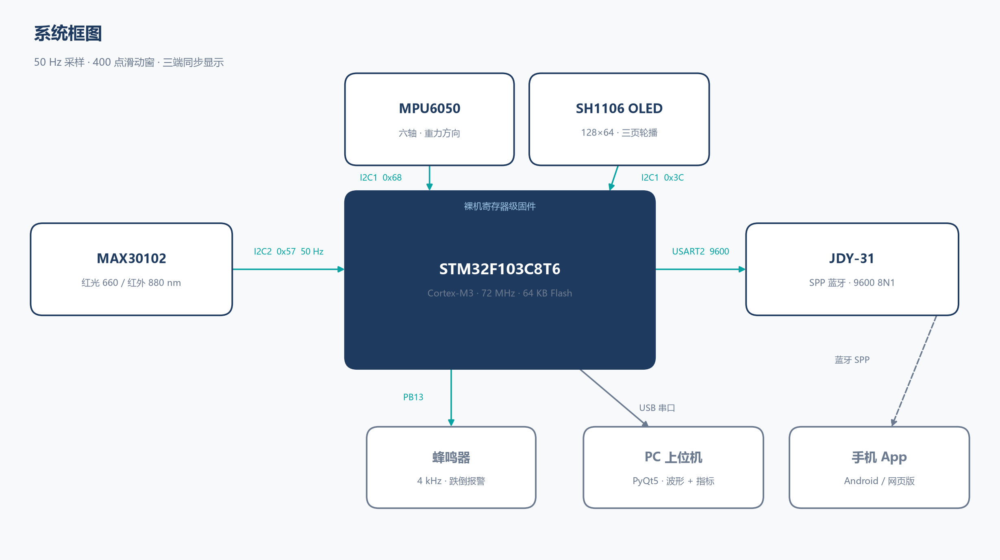
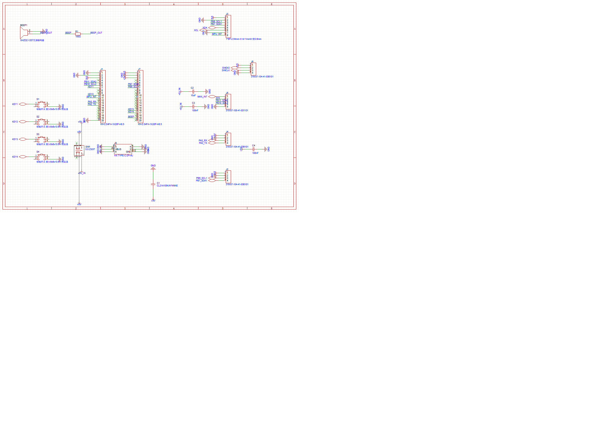
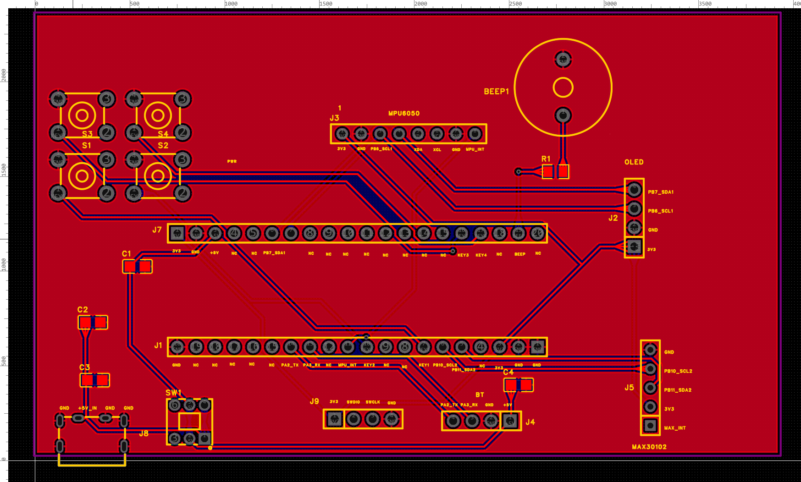

# STM32 + MAX30102 血氧/脉率监测系统

> 基于 STM32F103C8T6（Blue Pill）的指夹式 PPG 采集与算法验证平台：裸机固件完成 SpO2、脉率、灌注指数计算和跌倒检测，通过串口/蓝牙同步到电脑、手机网页与 Android App。

课程设计项目。重点不只是“能测”，而是把脉率判据从不稳做到可用：五轮算法迭代、失败判据、4 页 OLED 设置页和实测数据都保留在仓库里。



## 当前版本（2026-11-27）

- 固件：`02_固件/LED_Blink.hex`，86,760 B，SHA256 `90BCFB251F59D246E19B0F2DD48DB70CF8826A406729B7636013EEF3E16080B6`
- 固件源码：`02_固件/main.c`，125,865 B；`02_固件/CubeIDE工程` 可直接导入重建
- 上位机：`03_上位机/ppg_monitor.py`（PyQt5）与 `03_上位机/web_monitor.py`（零依赖网页版）
- Android：`06_Android手机端App/血氧监测.apk`，v3 记录页版本，542,107 B，SHA256 `3836801A42C4876AFC7AE7EE0FB081B0B7CDA21B33A3B127A64A9D5B9985C31A`
- 硬件：转接板 v6，设计文件与 Gerber 见 `05_设计资料/PCB工程_v6/`

## 硬件

| 部件 | 型号 | 接口 |
|---|---|---|
| MCU | STM32F103C8T6（Blue Pill，72 MHz） | — |
| 血氧传感器 | MAX30102（红光 660 nm / 红外 880 nm） | I2C2，地址 `0x57` |
| 六轴传感器 | MPU6050 | I2C1，地址 `0x68` |
| 显示屏 | SH1106 128×64 OLED | I2C1，地址 `0x3C` |
| 蓝牙 | JDY-31（SPP） | USART2，9600 8N1 |
| 蜂鸣器 | 无源，4 kHz | TIM1_CH1N |
| 转接板 | 自绘 v6（约 100×60 mm，Type-C 供电） | — |

固件引脚分配：

```text
I2C1   PB6/PB7   → OLED SH1106 (0x3C) + MPU6050 (0x68)
I2C2   PB10/PB11 → MAX30102 (0x57)
USART2 PA2/PA3   → JDY-31 (9600)
BEEP   PB13       LED PC13
KEY1-4 PB1 / PA6 / PA8 / PB15
```

### 硬件设计

转接板为立创 EDA 自绘。v6 修正了 S1–S4 按键接线与 J3（MPU6050）接口，并加入 Type-C 供电；18650 充放一体模块和电量 ADC 仍未接入，列入后续计划。

- v6 可编辑工程：[`PPG_STM32转接板_v6.epro2`](05_设计资料/PCB工程_v6/PPG_STM32转接板_v6.epro2)
- v6 Gerber 打板包：[`v6_gerber_打板定版.zip`](05_设计资料/PCB工程_v6/v6_gerber_打板定版.zip)
- v6 BOM：[`v6_BOM.csv`](05_设计资料/PCB工程_v6/v6_BOM.csv)
- v5 回退版保留在 [`05_设计资料/PCB工程`](05_设计资料/PCB工程)，用于对照

| v6 原理图 | v6 PCB |
|---|---|
|  |  |

## 功能

- **50 Hz 采样**，400 点滑动窗（8 s），每秒输出一次血氧/脉率/PI
- **脉率**：自相关 lag 投票 + 频域主判据双路，按灌注指数 PI 自动切换
- **血氧**：R 值查表，`SpO2 = 110 - 17R` 线性近似
- **灌注指数 PI**：AC/DC 比，反映末梢灌注强弱
- **跌倒检测**：MPU6050 冲击 → 静止 → 姿态角三阶段判据；跌倒报警 2 Hz，优先于心率报警
- **心率区间报警**：第 4 页设置 Min/Max，越界时蜂鸣器 1 Hz 间歇报警；OLED 不显示报警状态
- **4 页 OLED**：主界面 / IMU / 系统信息 / `4/4 SETTINGS`；S2 手动切页，S4 返回第 1 页，不自动轮播
- **设置页**：S1/S2 调 Min/Max（短按 ±1，长按 ±5），S3 切换 Min/Max，S4 返回；默认 60/100，范围 30–220，Min/Max 至少差 5
- **三端显示**：PyQt5 电脑上位机、标准库 HTTP + SSE 手机网页、原生 Android App
- **Android v3**：本机 SQLite 记录页、血氧/脉率/PI/姿态、跌倒独立记录；脉率区间内绿色、越界红色

## 实测指标

以手机健康 App 静息心率 **77 bpm** 为同刻对照（非医疗级设备，仅作相对基准）：

| 场景 | 样本 | 本机结果 | 偏差 |
|---|---|---|---|
| 稳态 90 s，固定压力 | n=97 | 75.3 ± 0.67 bpm | 1.7 |
| 4 分钟，每 30 s 换力度 | n=258 | 76.91 ± 3.28 bpm | 0.09 |

- 稳态标准差 **SD < 1 bpm**
- 启动收敛约 **11 s**
- 分辨率上限 **±4 bpm**（50 Hz 采样、400 点窗的物理约束，非参数可解）
- 手指在位时典型值：SpO2 97%、PI 3.4~8.7%

> 注意：这是教学/验证装置，**不是医疗设备**，数值不可用于诊断。

## 目录

```text
01_报告/              课设报告（定稿 + 过程稿，保留算法演进轨迹）
02_固件/              main.c、LED_Blink.hex、烧录与调试文档、版本更新_20261127.md
  CubeIDE工程/        STM32CubeIDE 完整工程（最新 4 页设置版源码）
  演进快照/           开发过程的源码备份
  历史固件/           各阶段里程碑 hex
03_上位机/            ppg_monitor.py（PyQt5）、web_monitor.py（HTTP + SSE）
04_验收数据/          采集 CSV、原始 400 点窗、可复跑采集脚本
05_设计资料/          v6 PCB 工程、Gerber、BOM、原理图/PCB 图、交接文档
06_Android手机端App/  MainActivity.java、v3 APK、使用说明
docs/                 README 用的系统框图
```

算法怎么一步步改过来的，看 `01_报告/课设报告_MAX30102脉率判据五轮演进_定稿_20261116.md`。

> 完整的 Word 课设报告含个人/学校信息，未纳入公开仓库；仓库内保留脱敏后的 Markdown 报告。

## 快速开始

### 编译固件

固件是裸机寄存器级实现（非 HAL），完整工程在 `02_固件/CubeIDE工程/`：

1. STM32CubeIDE：`File → Import → General → Existing Projects into Workspace`，选中该目录
2. `Project → Build`，产物在 `Debug/LED_Blink.elf` 与 `.hex`

也可直接使用已编译的 `02_固件/LED_Blink.hex`，不必自行编译。

### 烧录

```bash
STM32_Programmer_CLI.exe -c port=SWD freq=1000 -w 02_固件/LED_Blink.hex -v -rst -run
```

看到 `Download verified successfully` 即成功。详细参数见 `02_固件/STM32板子烧录与调试配置文档.md`。

### 电脑上位机

```bash
pip install -r 03_上位机/requirements.txt
python 03_上位机/ppg_monitor.py
```

选串口（代码默认 `COM8`，请改成你的端口）、9600，点连接。

### 手机网页版

```bash
python 03_上位机/web_monitor.py
```

手机浏览器打开终端打印的地址，保持同一局域网即可。

### Android App

1. 安装 `06_Android手机端App/血氧监测.apk`（Android 6.0+，debug 签名）
2. 系统蓝牙配对 `JDY-31-SPP`（PIN `1234`）
3. 回到 App 点右上角状态胶囊选择设备并连接
4. 底部 `开始记录` 开启本机记录；顶部 `记录` 打开数据记录页

> JDY-31 同一时刻只能连接一台主设备。手机连接前，电脑上位机必须先点“断开”。

## 通信协议

串口 9600 8N1，帧格式：

```text
AA 55 | type(1) | len(1) | payload(len) | checksum(1)
checksum = 前 4+len 字节求和 & 0xFF
```

| type | 含义 | payload |
|---|---|---|
| `0x01` | 测量结果，1 Hz | len=6：SpO2 / PR / PI(×10) / pitch+90 / roll+90 / state |
| `0x02` | 跌倒事件 | len=0 或 1 |
| `0x03` | 原始波形，25 Hz | len=6（IR×2）或 12（ir0/red0/ir1/red1，大端） |
| `0x04` | 心率上下限，1 Hz | len=2：hr_min / hr_max |

`state`：0 空闲、1 测量中、2 信号弱、4 跌倒。

上位机收到 `0x04` 后把脉率按区间着色：区间内绿色、越界红色、无有效值灰色。Android v3 同样处理，并在记录页按每条记录保存时的区间着色。

## Android v3 记录

- 记录保存在 App 私有 SQLite 数据库 `ppg_records.db`，不再写 `Android/data/...` CSV
- 顶部 `记录` 进入记录页；显示总条数、跌倒次数、当前 PR 正常区间
- 每条显示时间、SpO₂、PR、PI、状态、姿态；跌倒事件单独红色卡片
- 默认显示最近 300 条，最多保留 50,000 条；可刷新、清空
- `0x04` 区间每秒同步；默认 60–100，可在第 4 页修改

## 已知限制

1. 按键 S1–S4 已在 v6 硬件上修正，但旧 v5 板仍存在按键共用短地问题
2. v6 尚未接入 18650 充放模块与电量 ADC，移动供电需外部 Type-C
3. 无运动伪差抑制，晃动时脉率会漂
4. SpO2 未与医用血氧仪对照，仅有 PI/PR 的相对验证
5. `pr_val` 在手指拿开后不会超时清零
6. Android APK 为 debug 签名，仅适合侧载测试，不适合应用商店
7. Android v3 不导入旧 CSV；旧文件仍在手机原位置，但新 App 不读取
8. 固件源码保留若干未调用诊断函数，编译会有 unused-function 警告

## 许可

MIT License，见 [LICENSE](LICENSE)。报告与数据同样可自由引用，注明出处即可。

## 致谢

本项目的实现过程中使用了 AI 助手（豆包）辅助：

| 环节 | 协助内容 |
|---|---|
| 固件实现与调试 | 寄存器级外设初始化、脉率/血氧计算逻辑、烧录排错 |
| 算法迭代 | 五轮判据的设计讨论、实测数据的统计与归因 |
| 上位机 | PyQt5 串口端、标准库 HTTP + SSE 网页端、Android App 的功能实现与 UI |
| 文档 | 课设报告结构、README、交接文档的撰写与整理 |

原理图与 PCB 布线的设计决策、器件选型、实验方案与数据采集由作者本人完成。
